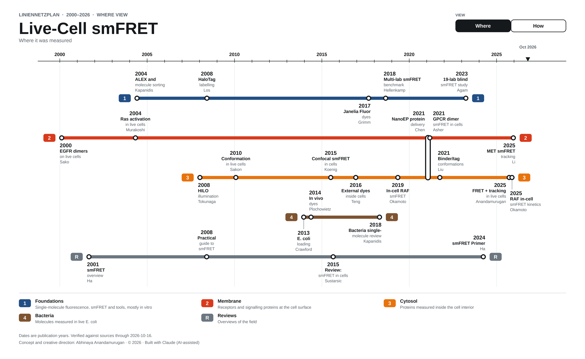
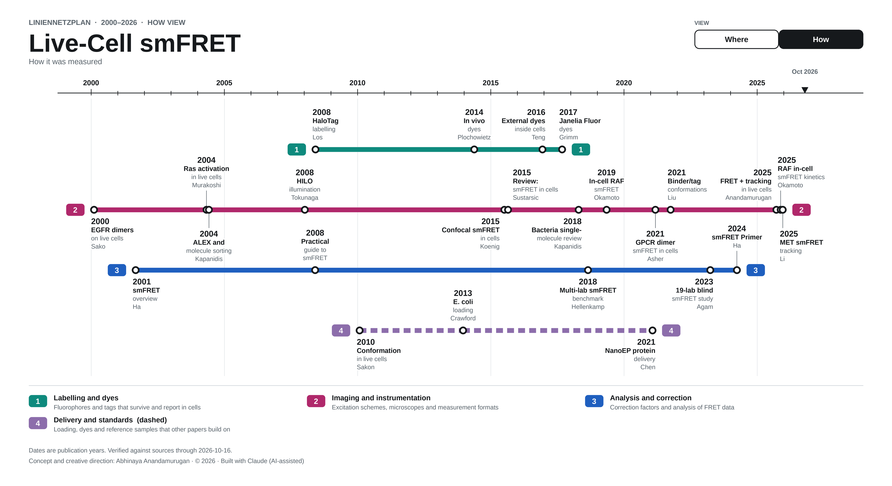
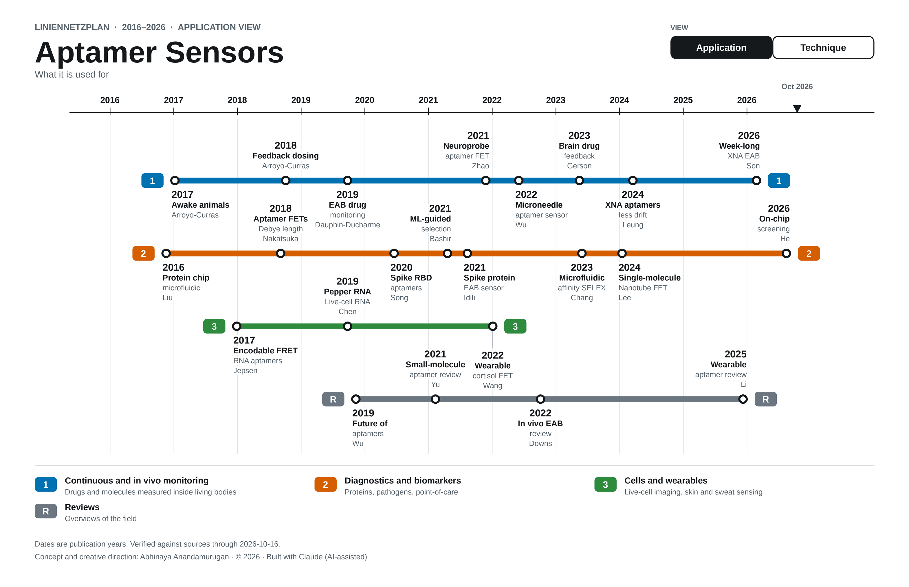
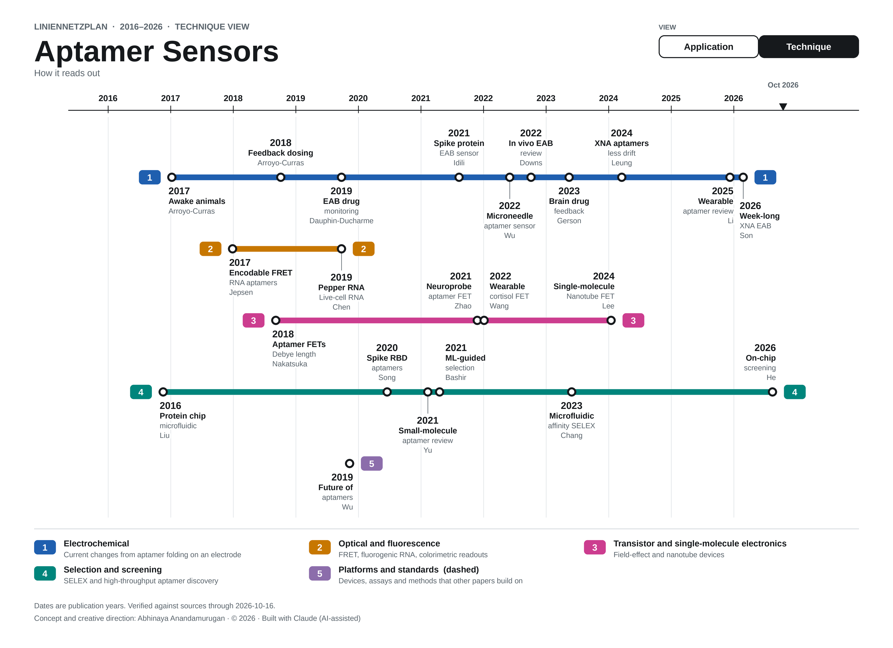

# Metro-timeline-map

Turn the history of a research field into a metro map. Each line is a group (a system, a method, a region), each station is a dated paper or milestone, and time runs left to right, in the style of a German Liniennetzplan. A toggle bar inside the figure switches between two ways of grouping the same stations.

The tool asks for a topic, a year range and the two views, researches the landmark papers with sources, and draws one PNG per view plus an interactive page with a working toggle.

## Try it

**Shared Claude artifact:** *(add the link here after sharing the artifact from claude.ai)*

## Examples

The single-molecule maps are examples of what the tool produces. Any field works.

| | |
|---|---|
|  |  |
|  |  |

Each map is a selection of milestones, not a full census. Every station carries a source, and any station whose authors or year were not re-checked is marked with a dagger.

## Install the skill

1. Download this repository and take the `metro-timeline-map` folder.
2. **Claude Code:** copy the folder to `~/.claude/skills/metro-timeline-map/`.
   **Claude app:** zip the `metro-timeline-map` folder and add it under Settings, Capabilities, Skills.
3. In Claude, run `/metro-timeline-map`.

## Run the renderer without Claude

You need Python 3 and Pillow.

```
pip install pillow
python metro-timeline-map/scripts/render_map.py \
  --data metro-timeline-map/examples/smfret-example.json \
  --from 2000 --until 2026 --title "Live-Cell smFRET" --out demo --html
```

This writes one PNG per view, a references file and an interactive page. Add `--credit "Your credit text"` to print a credit line in the footer of every map.

## Your own data

The data file lists the views, their lines and the stations (year, label, citation, link to the source). `metro-timeline-map/examples/smfret-example.json` shows the format, and `metro-timeline-map/SKILL.md` describes every field.

## How to cite

If you use this tool or a map made with it, please cite it:

> Anandamurugan, A. (2026). *Metro-timeline-map* (Version 1.0.0) [Computer software]. GitHub. https://github.com/Nautilus-HKEY/Metro-timeline-map

BibTeX:

```bibtex
@software{anandamurugan2026metrotimeline,
  author  = {Anandamurugan, Abhinaya},
  title   = {Metro-timeline-map},
  year    = {2026},
  version = {1.0.0},
  url     = {https://github.com/Nautilus-HKEY/Metro-timeline-map},
  note    = {Built with Claude (AI-assisted)}
}
```

GitHub also reads `CITATION.cff` and shows a "Cite this repository" button on the repo page. For a permanent DOI, link the repository to Zenodo and cut a release.

## Credit and license

Concept and creative direction: Abhinaya Anandamurugan. Built with Claude (AI-assisted).

Released under the MIT License (see `LICENSE`).
